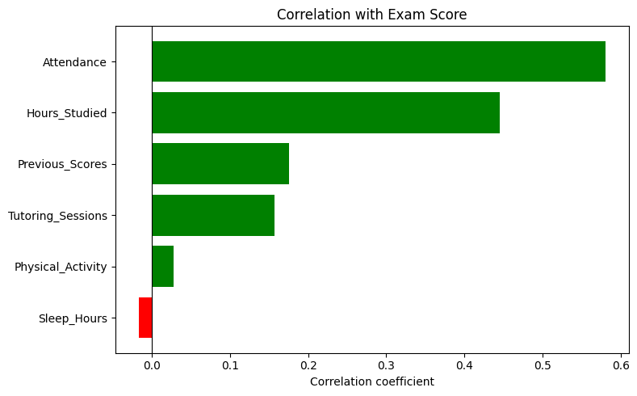
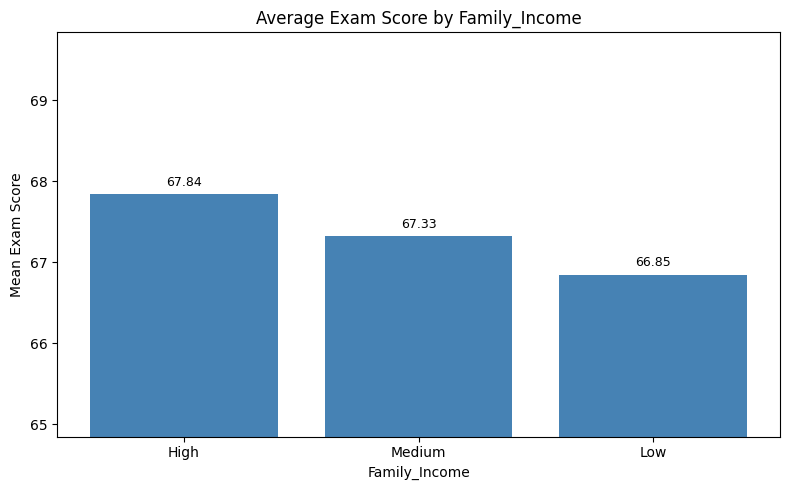
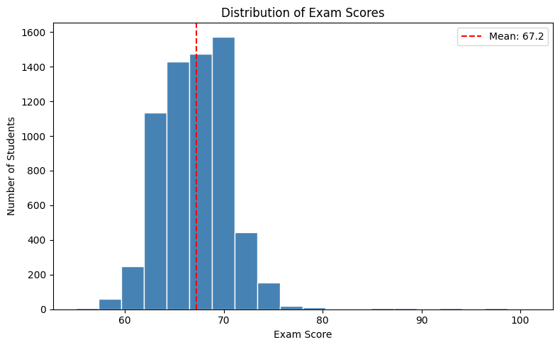

# Student Performance Analysis

An exploratory data analysis project investigating the relationship between behavioral, motivational, and socioeconomic factors and student academic performance using Python, statistical methods, and data visualization.

## 📌 Overview

The objective of this project is to identify and examine the factors that have the strongest relationship with students' academic performance, particularly exam scores.

Using Python and several data science libraries, we explored how factors such as attendance, study habits, motivation, family income, and school type relate to academic outcomes.

The project was developed as a team of two for the **DS120 – Programming for Data Science** course at the American University of Armenia.

## 📊 Dataset

The analysis uses the [*Student Performance Factors*] (https://www.kaggle.com/datasets/fatihyavuzz/studentperformancefactors) dataset from Kaggle.

- **Number of observations:** 6,607 students
- **Number of features:** 20
- **Data types:** Numerical and categorical

The dataset includes variables such as:

- Hours studied and sleep duration
- Attendance and previous academic scores
- Motivation and peer influence
- Family income and parental involvement
- School type and tutoring sessions

Gender, distance from home, and learning disabilities were treated as additional variables and analyzed separately.

> The CSV file is not included in this repository. Download it from Kaggle and place `StudentPerformanceFactors.csv` in the project folder.

## 🛠️ Technologies & Libraries

- **Python** – Main programming language
- **Pandas** – Data manipulation and preprocessing
- **NumPy** – Numerical operations
- **Matplotlib** – Data visualization
- **Object-Oriented Programming (OOP)** – Modular project architecture

## 🔍 Analysis & Methodology

The project is divided into three main stages:

### 1. Data Preprocessing

- Loading and inspecting the dataset
- Selecting relevant columns
- Removing duplicate observations
- Correcting data types
- Handling missing values (median for numerical columns, mode for categorical columns)

### 2. Statistical Analysis

- Correlation analysis to examine relationships between numerical variables
- Group aggregation (mean, median, standard deviation) to compare exam scores across categorical variables
- Statistical summaries of numerical features

### 3. Data Visualization

- Exam score distribution histogram
- Correlation bar chart
- Group comparison visualizations
- Separate visual analysis of additional variables

## 💡 Key Findings

### Correlation with exam score



- **Attendance** showed the strongest positive correlation with exam scores (0.58).
- **Hours studied** followed with a positive correlation of 0.45.
- **Previous scores** (0.18) and **tutoring sessions** (0.16) showed weaker positive correlations.
- **Sleep hours** (-0.02) and **physical activity** (0.03) showed no meaningful relationship with exam scores.

### Exam score by family income



*Note: the y-axis is zoomed in (it starts near 65, not 0). Students from high-income families scored about 1 point higher on average than those from low-income families (67.84 vs 66.85).*

Students with higher motivation levels and students in private schools also had higher average scores, with similarly small differences.

### Distribution of exam scores



Exam scores followed an approximately normal distribution with a mean of about 67.2, with a few high outliers near 100.

### Additional variables

Gender made no difference to average exam scores (67.24 vs 67.23). Learning disabilities and distance from home were associated with slightly lower averages (about 1 point).

## ⚠️ Limitations

- These findings describe associations within the dataset and do not establish causal relationships. For example, attendance and scores move together, but this analysis cannot say which drives the other.
- Group differences (income, motivation, school type) are small, about 1 point on average, and the group charts use a zoomed-in y-axis.
- The analysis is descriptive. No predictive models were trained.

## 📁 Project Structure

```text
Student-Performance-Analysis/
│
├── dataset.py       # Data loading and preprocessing
├── analyzer.py      # Statistical analysis and aggregation
├── visualizer.py    # Data visualization
├── main.py          # Main execution pipeline
│
├── images/          # Charts used in this README
├── requirements.txt
├── Report.pdf
└── README.md
```

### Code Architecture

The project follows a modular, object-oriented structure:

- **DatasetHandler:** Responsible for loading, cleaning, and preparing the dataset.
- **StudentAnalyzer:** Implements correlation analysis, group aggregation, and statistical summaries.
- **StudentVisualizer:** Generates visual representations of the analysis results.
- **main.py:** Integrates the modules and executes the complete analysis pipeline.

## 🚀 Getting Started

### Prerequisites

Make sure you have Python 3 installed, then install the required libraries:

```bash
pip install -r requirements.txt
```

### Running the Project

1. Clone the repository:

```bash
git clone https://github.com/HapBub/Student-Performance-Analysis
```

2. Navigate to the project directory:

```bash
cd Student-Performance-Analysis
```

3. Download the dataset from Kaggle and place `StudentPerformanceFactors.csv` in the project directory.

4. Run the main script:

```bash
python main.py
```

## 📄 Project Report

For a more detailed explanation of the methodology, analysis, findings, and project development, see the [Full Project Report (PDF)](Report.pdf).

## 👥 Contributors

**Davit Meliksetyan**

- Led the development of the data loading and preprocessing module.

**Serine Ananyan**

- Led the development of the data visualization module.

Both contributors collaborated on the statistical analysis and overall project architecture.

## 📜 License

Released under the MIT License. The dataset is the property of its original authors; see its Kaggle page for terms.

---

*Developed as part of DS120 – Programming for Data Science, American University of Armenia (May 2026).*
